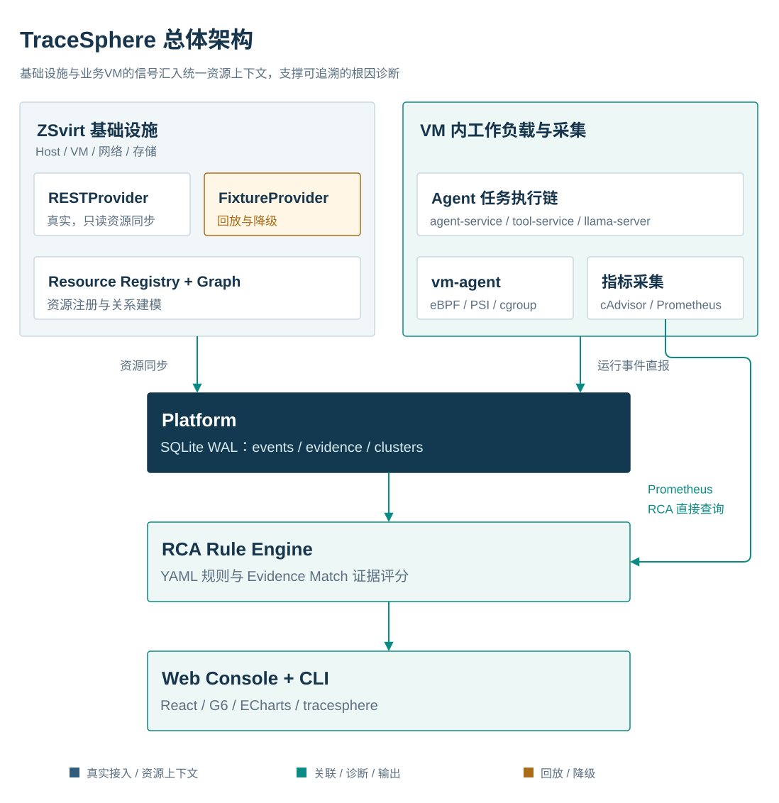

# TraceSphere

> Full-stack observability and root-cause diagnosis for containerized and agent workloads inside ZSvirt virtual machines
> Shanghai Open Source Software Application Innovation Competition (上海开源软件应用创新大赛) · Built on ZSvirt

[中文](README.md) | English

TraceSphere is organized around three ideas: **VM as the boundary, workload as the object, and event correlation as the core**. It unifies metrics, structured events, and alert evidence into one traceable chain and answers one operational question:

**When an agent task fails, is the cause the application, the container, the VM, the GPU, or the host?**



## Repository layout

```text
tracesphere/
├── vm-agent/        # VM-side probe (Go + cilium/ebpf + PSI/cgroup; systemd install/uninstall)
├── workload/        # Sample AI workload (agent-service / tool-service / llama.cpp / Toxiproxy / Prometheus / cAdvisor)
│   ├── faults/      #    Fault injection scripts (OOM / CPU / network)
│   └── mock/        #    Mock DCGM GPU-memory source (no-GPU degraded mode)
├── platform/        # Platform (ZSvirt providers, resource graph, evidence store, correlation engine, HTTP API)
├── rca/             # Diagnosis (Rule Engine, four YAML rules, Evidence Match, CLI, fixture replay)
├── console/         # Web Console (React + TypeScript + AntD + G6 + ECharts)
├── deploy/          # Deployment scripts (ZSvirt environment / VM bootstrap / systemd units)
├── tools/           # Integration tools (demo-up / acceptance / scenario injection / evidence chain)
├── docs/            # Solution, deployment, testing, user guide, evidence, demo material
│   └── en/          # English documentation set
└── LICENSE          # MIT
```

## Documentation

| Document | Contents |
|---|---|
| [English documentation index](docs/en/README.md) | Entry point for the English documentation set |
| [Solution overview](docs/en/solution-overview.md) | Architecture, data model, collection, correlation, alerting, ZSvirt integration |
| [Deployment guide](docs/en/deployment-guide.md) | Three deployment modes, ZSvirt and workload VM setup, platform/RCA/Console, operations, troubleshooting |
| [Testing guide](docs/en/testing-guide.md) | Test strategy, four-scenario acceptance, security and performance, defects, known limitations |
| [User guide](docs/en/user-guide.md) | Console pages, incident operations, diagnosis interpretation, CLI, FAQ |
| [Project introduction](docs/en/project-introduction.md) | Positioning, architecture, scenarios, innovation, delivery forms, boundaries |
| [中文方案说明](docs/方案说明.md) | Chinese solution overview |
| [中文部署文档](docs/部署文档.md) | Chinese deployment guide |
| [中文测试文档](docs/测试文档.md) | Chinese testing guide |
| [中文用户手册](docs/用户手册.md) | Chinese user guide |

## Minimum environment

| Item | Requirement |
|---|---|
| Host | Linux x86_64 (KVM + nested virtualization), 20 vCPU / 30 GiB / 100 GiB free disk |
| Virtualization | libvirt + qemu-kvm + virt-install (x86_64) |
| ZSvirt | v1.0.0 qcow2 (x86_64, official download); management node 8 vCPU / 8 GiB or more |
| Business VM | Ubuntu 24.04 (4 vCPU / 4 GiB / 40 GiB), Docker Engine + Compose |
| Platform side | Python 3.10+ (no third-party dependencies), Node 22 (Console build only), Go 1.25+ (vm-agent), Go 1.22+ (RCA/CLI) |
| GPU | Optional; CPU inference with llama.cpp and Mock DCGM provide a no-GPU path |

Third-party dependencies (all open source):

| Component | Version (tested) | License |
|---|---|---|
| llama.cpp (server image) | latest | MIT |
| Qwen3.5-0.8B GGUF | Q8_0 | Apache-2.0 |
| Prometheus / cAdvisor | v2.53 / v0.49.1 | Apache-2.0 |
| Toxiproxy | latest | MIT |
| cilium/ebpf (Go) | v0.22.0 | MIT |
| AntV G6 / ECharts / React / AntD | see `console/package.json` | MIT / Apache-2.0 |
| SQLite | 3.x (Python built-in) | Public Domain |

## Quick start (from scratch)

### 1) Environment and credentials

```bash
export ZSVIRT_PASSWORD='<ZSvirt admin password>'       # used by the platform to connect to ZSvirt
export TRACESPHERE_VM_UUID='<ZSvirt VM uuid>'          # UUID of workload-vm
export TRACESPHERE_VM_HOST='<business VM IP>'          # e.g. 192.0.2.10
export VM_PASSWORD='<business VM SSH password>'        # ubuntu user
export TRACESPHERE_PLATFORM_URL='http://<platform IP>:8000'  # reachable from the business VM
```

The scripts under `tools/` read deployment parameters from these environment variables; the repository contains no real addresses or credentials.

### 2) Platform side (platform + RCA services)

```bash
# Data and configuration
cp platform/config/platform.example.json platform/config/platform.json   # edit as needed
sudo install -d /etc/tracesphere
printf 'ZSVIRT_PASSWORD=%s\n' "$ZSVIRT_PASSWORD" | sudo tee /etc/tracesphere/platform.env

# Build and start (systemd)
cd rca && go build -o bin/tracesphere ./cmd/tracesphere && cd ..
cd console && npm ci && npm run build && cd ..
sudo bash deploy/systemd/install-services.sh
bash tools/demo-up.sh --status        # platform / RCA / vm-agent status
# Console: http://<platform IP>:8010/
```

Set `TRACESPHERE_API_TOKEN` in `/etc/tracesphere/platform.env` for any non-loopback deployment. Set `TRACESPHERE_PLATFORM_TOKEN` in `/etc/tracesphere/rca.env` to the same value, and optionally set `TRACESPHERE_RCA_TOKEN` for Console access.

### 3) Business VM side (probe + sample workload)

```bash
# vm-agent (eBPF + PSI/cgroup, systemd)
cd vm-agent && make build && cd ..
sudo bash vm-agent/deploy/install.sh vm-agent/bin/vm-agent
sudo tee /etc/tracesphere/agent.env >/dev/null <<EOF
VMAGENT_PLATFORM_URL=$TRACESPHERE_PLATFORM_URL
VMAGENT_VM_UUID=$TRACESPHERE_VM_UUID
VMAGENT_REPORT_PROCESS=0
EOF
sudo systemctl restart tracesphere-vm-agent

# Sample workload (Docker Compose)
cd /opt/tracesphere/workload
# Put PLATFORM_EVENTS_URL / TRACESPHERE_VM_UUID / PLATFORM_TOKEN in the same-directory .env
# (see workload/.env.example)
sudo docker compose up -d
bash toxiproxy-init.sh
```

`VMAGENT_PLATFORM_URL` is a base URL (host and port only); vm-agent appends `/api/v1/events`. By contrast, `PLATFORM_EVENTS_URL` in the workload `.env` is the full event endpoint.

### 4) Smoke test

```bash
bash tools/demo-up.sh --status
bash /opt/tracesphere/workload/faults/run-task.sh 'hello'    # trigger one agent task
curl -s http://127.0.0.1:8000/api/v1/health                  # platform: event count should grow
cd rca && ./bin/tracesphere alerts --window 10m               # incidents / events
```

## Four-scenario acceptance

Real injection → collection → correlation → diagnosis:

```bash
# Export the environment variables from §1 first
# (TRACESPHERE_VM_HOST / TRACESPHERE_VM_UUID / VM_PASSWORD / ZSVIRT_PASSWORD ...)
bash tools/acceptance.sh
# Outputs: /tmp/final/case{1,2,3,4}*.txt (RCA reports) + rca/fixtures/*.json (captured replay data)
```

| Scenario | Injection | Expected result |
|---|---|---|
| Case 1 container OOM | Tighten the `tool-service` memory limit | Kernel OOM evidence + container restart + task failure → Top-1 "container memory exhausted" **99/100** |
| Case 2 CPU contention | `cpu-stress` + tighten the llama CPU quota | PSI rise + CPU throttling + task failure → Top-1 "CPU resource contention" **85/100** |
| Case 3 tool call failure | Disable the Toxiproxy tool proxy | `tool.result` error + `task.failed` (application events) → Top-1 "agent tool call failure" **67/100** |
| Case 4 GPU memory exhaustion (degraded) | Mock DCGM `/inject mode=exhaust` | GPU memory ratio > 90% + exhaustion event → Top-1 "GPU memory exhaustion" **89/100** |

Evidence boundaries:

- **Case 3** evidence in the cited run was application events only; there was no transport-layer or kernel evidence. The conclusion is the tool-call failure, not proof of a network transport anomaly.
- **Case 2** had no inference-latency evidence in the cited run; the conclusion rests on PSI, CPU throttling, and task failure.
- **Case 4** is a degraded demonstration without GPU hardware: the platform runs with `TRACESPHERE_MOCK_GPU=1` (registering `Host →contains→ GPU →assigned_to→ VM`), and the `mock-dcgm` container reports simulated metrics. Metric names are `ts_gpu_*`; they are semantically compatible with a real DCGM exporter but are not the real DCGM naming. Replacing the source with a real DCGM exporter does not require changing the rule.
- Evidence Match is a rule-evidence hit score (0–100), **not a probability**. The four scores are controlled-scenario results, not a general accuracy claim.

Historical acceptance records and evidence chains: `docs/evidence/` (three-case chain reports, RCA real-environment acceptance, probe overhead).

## Data contract (Schema v1)

- **Schema v1**: `schema_version / origin / mode / observed_at / ingested_at / type / event_type / resource_id / correlation_id / trace_id / task_id / severity / source / cluster_id / payload`
- **Resource model**: Host → VM → Container → Process / Service → Task; the relation vocabulary is available at `GET /api/v1/meta`.
- **Evidence naming**: `rca/docs/API.md §1` (`memory.events.oom_kill`, `psi_cpu_some_avg10`, `task.failed`, ...).
- **Diagnosis output**: Evidence Match 0–100 (evidence-hit score, not probability), with evidence IDs traceable to source events.

## ZSvirt integration and permissions

**Platform → ZSvirt (read-only)**:

| Item | Description |
|---|---|
| Login | `PUT /zstack/v1/accounts/login` (password field is the SHA-512 hex digest; session header `Authorization: OAuth <sessionId>`; automatic re-login on 401/403) |
| Inventory | `hosts` / `vm-instances` / `clusters` / `zones` / `images` / `l3-networks` / `l2-networks` / `l2-networks/port-groups` / `primary-storage` / `backup-storage` / `instance-offerings` (paths configurable) |
| Alarms | `zwatch/alarms`, `zwatch/events` (normalized into Schema v1 alert events) |
| Permission scope | One account performs read-only queries (inventory GET + login). The code does not call any write API and does not modify ZSvirt resources. Read-only access is guaranteed by code discipline, not by restricted account privileges. |
| Credentials | Password is injected through `ZSVIRT_PASSWORD` into `/etc/tracesphere/platform.env` (mode 600); never committed or logged |

**VM-side probe (vm-agent)**:

| Item | Description |
|---|---|
| Runtime identity | systemd service, root by default (eBPF attach and kernel journal reads); a least-privilege `CAP_BPF + CAP_PERFMON` template is documented in the unit file |
| Collection | cgroup v2 direct read, PSI files, eBPF tracepoints (exec/exit/OOM/retransmit; automatic degradation on failure), kernel OOM pattern matching |
| Uninstall | `sudo bash vm-agent/deploy/uninstall.sh` (stops the service, removes the unit and binary, keeps evidence) |

**Port exposure** (minimal by default): platform 8000 (with `TRACESPHERE_API_TOKEN`; non-loopback binding without a token is refused), RCA + Console 8010 (optional `TRACESPHERE_RCA_TOKEN`; write endpoints are rate-limited). Prometheus / cAdvisor / llama / Toxiproxy / mock-dcgm / the agent `/task` endpoint bind to loopback by default; cross-host Prometheus reads use `PROM_BIND`, and the agent task endpoint can use `TASK_TOKEN`.

## Security and sanitization

- **Collection minimization**: events are structured fields (type / resource / time / severity / payload). Container stdout and business request bodies are not collected. Kernel logs are pattern-matched for OOM; raw text is not stored.
- **Field filtering**: platform ingest normalizes events against the Schema v1 whitelist (`platform/tsplatform/schema.py`); unknown fields are kept under `payload` and are not promoted to new columns.
- **Access control**: static token for the platform API (`TRACESPHERE_API_TOKEN`); optional RCA token (`TRACESPHERE_RCA_TOKEN`); write endpoints are rate-limited per IP per minute; workload control planes bind to loopback by default.
- **Privacy**: agent-service reports structured metadata only (question/answer lengths, not their text).
- **Submission sanitization**: `tools/sanitize-for-submission.sh` excludes internal documents, replaces internal network ranges / VM UUIDs / password-like strings, and runs a residue scan that fails on any hit.

## Documentation boundary

- This English README and the `docs/en/` set are provided for GitHub readers. They mirror the Chinese technical content and keep the same evidence boundaries.
- The Chinese submission package follows the boundary in [README.md](README.md). Internal handover documents, fix logs, and environment-specific deployment records are not part of the public package.
- `docs/evidence/` contains sanitized acceptance reports; `docs/en/` adds no new claims beyond those reports.

## Demo video

A 4 min 30 s walkthrough (normal workload → four fault injections → correlation clusters and evidence chains → Top-1 root cause and remediation):

- Gitee: https://gitee.com/shibuchou/TraceSphere/raw/main/docs/video/tracesphere-demo.mp4
- GitHub mirror: https://github.com/shibuchou/TraceSphere/raw/main/docs/video/tracesphere-demo.mp4
- Files and notes: `docs/video/`

## License

The project code is released under the MIT License (see `LICENSE`). Referenced open-source components retain their own licenses (Prometheus / cAdvisor / Toxiproxy / llama.cpp / cilium-ebpf / AntV G6 / React / AntD, etc.; see the table above). Oracle and third-party trademarks belong to their respective owners.
