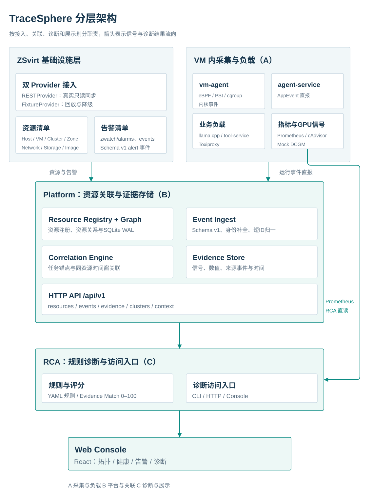

# TraceSphere Deployment Guide

> A full-stack observability platform for container and agent workloads inside ZSvirt virtual machines
> Shanghai Open Source Software Application Innovation Competition (上海开源软件应用创新大赛) · Built on the ZSvirt virtualization platform
> Document version: v1.0 (2026-10-27) | Code: tracesphere repository main branch

[中文](../部署文档.md) | English

---

## 1. About This Document

### 1.1 Scope

This document covers the three deployment modes of TraceSphere:

| Mode | Use case | Requires ZSvirt | Requires workload VM | Data source |
|---|---|---|---|---|
| A. Full live deployment | Acceptance, demos, real troubleshooting | Yes | Yes | ZSvirt REST + vm-agent + AppEvent + Prometheus |
| B. Platform + replay | Reviews without a cloud environment, offline reproduction | No | No | `rca/fixtures/*.json` |
| C. Console-only replay | Front-end demos, screen recording | No | No | `console/src/mocks/*.json` |

### 1.2 Related Documents

| Document | Purpose |
|---|---|
| [README](../../README.en.md) | Project overview, quick start, API and permission statements |
| [Solution Overview](solution-overview.md) | Architecture, data model, collection and diagnosis design |
| [Testing Guide](testing-guide.md) | Test strategy, test cases, acceptance records, and known limitations |
| [User Guide](user-guide.md) | How to use the Console and CLI |
| [RCA API Contract](../../rca/docs/API.md) | Rule structure, evidence model, and the diagnosis HTTP API |
| [Platform API Reference](../../platform/README.md) | `/api/v1` platform APIs and data contracts |
| [vm-agent Reference](../../vm-agent/README.md) | vm-agent collection capabilities, build, and degradation |
| `deploy/README.md` | ZSvirt deployment notes from one tested environment (**internal material, not distributed with the submission package**) |

### 1.3 Conventions

- Every `<...>` in this document is a placeholder; replace it with the actual value at deployment time.
- All passwords, tokens, and internal network addresses go only into `/etc/tracesphere/*.env` or the deployer's environment variables. Never write them into the repository or the shell history.
- Commands are run in a Linux shell by default; platform-side and workload-VM-side operations are labeled separately.
- All times use UTC. The correlation window defaults to ±5 seconds; clock synchronization across all nodes must be guaranteed before deployment.

---

## 2. Deployment Architecture

### 2.1 Logical Topology



```text
┌────────────────────────────────────────────────────────────────────────┐
│ ZSvirt management node (<MN_IP>)                                       │
│   UI 443 | REST API 8080 (/zstack/v1)                                  │
│   Zone / Cluster / Host / Storage / L2-L3 Network / Image / Offering   │
└──────────────────────────────┬─────────────────────────────────────────┘
                               │ Read-only inventory + zwatch queries
┌──────────────────────────────▼─────────────────────────────────────────┐
│ Platform node (<PLATFORM_IP>, may be co-located with the KVM host)     │
│   platform  :8000  resource graph / events / evidence / correlation    │
│   rca       :8010  rule diagnostics + Console static hosting           │
│   console/dist     React build output                                  │
└──────────────────────────────┬─────────────────────────────────────────┘
                               │ Event reporting / metric reads / page access
┌──────────────────────────────▼─────────────────────────────────────────┐
│ Workload VM (<VM_IP>, managed by ZSvirt)                               │
│   vm-agent (eBPF + PSI + cgroup + journal, systemd)                    │
│   Docker Compose: agent-service / tool-service / llama-server          │
│   Toxiproxy / Prometheus / cAdvisor / mock-dcgm                        │
└────────────────────────────────────────────────────────────────────────┘
```

### 2.2 Component Responsibilities

| Component | Deployment location | Runtime form | Responsibility |
|---|---|---|---|
| `platform` | Platform node | systemd `tracesphere-platform`, port 8000 | Read-only ZSvirt sync, resource graph, event ingestion, evidence and correlation clusters |
| `rca` | Platform node | systemd `tracesphere-rca`, port 8010 | YAML rule matching, Evidence Match scoring, diagnosis API, Console hosting |
| `console` | Platform node | Static files served by RCA | Topology (拓扑) / Health (健康) / Incidents (告警) / Diagnosis (诊断) pages |
| `vm-agent` | Workload VM | systemd `tracesphere-vm-agent` | Kernel event, PSI, cgroup, and OOM log collection and direct reporting |
| `workload` | Workload VM | Docker Compose | Reproducible agent business chain and fault injection |
| `mock-dcgm` | Workload VM | Container | Simulated GPU memory metric source for environments without a GPU |

### 2.3 Data Flow

1. On startup, platform logs in to ZSvirt and pulls inventories such as host / VM / cluster / zone / network / storage / image / offering / alarm, then generates resources and edges;
2. Inside the workload VM, vm-agent and agent-service report events directly through `POST /api/v1/events`;
3. RCA reads platform context through `GET /api/v1/context`, `/clusters`, and `/events`, and also reads container metrics from Prometheus;
4. RCA performs rule matching and outputs root-cause candidates, evidence IDs, impact scope, and recommended actions;
5. The Console calls RCA through the same-origin `/api/v1`, and the pages display topology, health, incidents, and diagnosis.

---

## 3. Environment Requirements

### 3.1 Hardware

| Item | Minimum | Tested environment |
|---|---|---|
| Host machine | Linux x86_64, 8 vCPU / 16 GiB / 100 GiB free disk | 20 vCPU / 30 GiB / 176 GiB |
| Virtualization | KVM + nested virtualization (`kvm_intel.nested=1`) | Yes |
| ZSvirt management node VM | 8 vCPU / 8 GiB | 12 vCPU / 16 GiB |
| Workload VM | 4 vCPU / 4 GiB / 40 GiB | 4 vCPU / 4 GiB / 40 GiB |
| GPU | Optional; without a GPU, degrade to Mock DCGM | No GPU |

### 3.2 Software

| Software | Version | Purpose |
|---|---|---|
| ZSvirt | v1.0.0 (x86_64 qcow2) | Virtualization management platform |
| libvirt / qemu-kvm / virt-install | Provided by the distribution | Boot the ZSvirt management node |
| Ubuntu | 24.04 LTS | Workload VM |
| Docker Engine + Compose v2 | 24+ / v2 | Sample workload |
| Python | 3.10+ (platform has zero third-party dependencies) | platform |
| Go | 1.22+ (RCA) / 1.25+ (vm-agent) | Build the diagnostics service and the agent |
| Node.js | 22 | Build the Console |
| clang / bpftool / BTF | Kernel 6.8+ provides `/sys/kernel/btf/vmlinux` | vm-agent eBPF |
| SQLite | 3.x (bundled with Python) | Local platform storage |
| Prometheus / cAdvisor / Toxiproxy / llama.cpp | See the Compose image digests | Sample workload |

### 3.3 Network and Ports

| Node | Port | Default binding | Description |
|---|---|---|---|
| ZSvirt management node | 443 | UI | Browser initialization; does not proxy `/zstack` |
| ZSvirt management node | 8080 | REST API | platform accesses it through `http://<MN_IP>:8080/zstack/v1` |
| Platform node | 8000 | `0.0.0.0` (production) | platform API; a token is mandatory for non-loopback bindings |
| Platform node | 8010 | `:8010` | RCA API + Console |
| Workload VM | 22 | SSH | Deployment and operations |
| Workload VM | 9090 | `PROM_BIND`, loopback by default | Prometheus; bind to the VM IP for cross-host reads |
| Workload VM | 8080 | `BIND_ADDR`, loopback by default | cAdvisor |
| Workload VM | 8081 | `BIND_ADDR`, loopback by default | llama-server |
| Workload VM | 8082 | `BIND_ADDR`, loopback by default | agent-service `/task` |
| Workload VM | 8474 / 8666 | `BIND_ADDR`, loopback by default | Toxiproxy control plane / tool proxy |
| Workload VM | 9400 | `BIND_ADDR`, loopback by default | mock-dcgm `/metrics` and `/inject` |
| Workload VM | 9000 | Container network | tool-service, not published to the host |

### 3.4 Time and Clocks

- Enable NTP / chrony on all nodes;
- Clock skew between platform and ZSvirt should be < 1 second; the correlation window defaults to 5 seconds;
- Skew between the workload VM and the platform node should likewise be < 5 seconds; otherwise application events and system events cannot be grouped into the same correlation cluster;
- Check commands:

```bash
timedatectl status
chronyc tracking 2>/dev/null || ntpq -p 2>/dev/null || true
```

---

## 4. Pre-Deployment Preparation

### 4.1 Planning Table

Fill in the table below before deployment; later commands reference it directly:

| Variable | Example | Description |
|---|---|---|
| `MN_IP` | `192.0.2.10` | ZSvirt management node IP |
| `PLATFORM_IP` | `192.0.2.20` | Platform node IP (reachable from the workload VM) |
| `VM_IP` | `<VM_IP>` | Workload VM IP |
| `VM_UUID` | `<ZSvirt VM uuid>` | UUID of the workload VM in ZSvirt |
| `ZSVIRT_PASSWORD` | `<ZSvirt admin password>` | Written to environment variables only |
| `API_TOKEN` | generated by `openssl rand -hex 24` | platform static token |
| `RCA_TOKEN` | generated by `openssl rand -hex 24` | RCA static token (optional but recommended) |
| `VM_PASSWORD` | `<ubuntu user password>` | Used by deployment scripts only |

### 4.2 Host Machine Checks

```bash
# Nested virtualization
egrep -c '(vmx|svm)' /proc/cpuinfo
cat /sys/module/kvm_intel/parameters/nested 2>/dev/null || true
ls -l /dev/kvm

# libvirt
virsh list --all
virsh net-list --all
```

### 4.3 Workload VM Kernel Checks (vm-agent Prerequisites)

```bash
uname -r
test -f /sys/kernel/btf/vmlinux && echo "BTF OK"
mount | grep tracefs || echo "tracefs not mounted"
cat /proc/pressure/cpu >/dev/null && echo "PSI OK"
stat -fc %T /sys/fs/cgroup   # expected: cgroup2fs
```

eBPF requires root or `CAP_BPF + CAP_PERFMON`; tracepoints depend on tracefs. If any condition is not met, vm-agent automatically degrades to PSI/cgroup collection and deployment is not blocked.

### 4.4 Directory Layout

For a full deployment, keep everything under `/opt/tracesphere`, because the sample workload's Compose file uses absolute-path mounts:

```text
/opt/tracesphere/
├── platform/                 # platform code and data/tracesphere.db
├── rca/                      # diagnostics service and rules/ fixtures/
├── console/                  # front-end source and dist/
├── vm-agent/                 # agent source and bin/vm-agent
├── workload/                 # sample workload (Compose, fault scripts)
├── models/model.gguf         # sample model (not in the repository)
├── deploy/                   # deployment scripts and systemd units
└── tools/                    # demo-up / acceptance / reset-platform
```

```bash
sudo install -d -o "$USER" -g "$USER" /opt/tracesphere
sudo install -d -o "$USER" -g "$USER" /opt/tracesphere/models
sudo install -d /etc/tracesphere
```

> `tools/acceptance.sh` currently assumes the repository is at `$HOME/tracesphere` and the workload is at `/opt/tracesphere/workload`. If you deploy to `/opt/tracesphere`, change `cd "$HOME/tracesphere/rca"` in the script to the actual path, or place the repository at `$HOME/tracesphere` and create a `/opt/tracesphere` symlink.

### 4.5 Generating Tokens

```bash
openssl rand -hex 24        # API_TOKEN
openssl rand -hex 24        # RCA_TOKEN
```

Store tokens only in `/etc/tracesphere/platform.env` and `/etc/tracesphere/rca.env`, with mode 600.

---

## 5. ZSvirt Management Node and Workload VM

> This section gives the general steps and flags the known issues and workarounds from this repository's tested environment. UI wording may differ between ZSvirt versions; always follow the actual interface.

### 5.1 Obtaining and Verifying the ZSvirt Image

Obtain the ZSvirt v1.0.0 x86_64 qcow2 from the official release channel. `deploy/zsvirt-deploy.sh` in this repository embeds the image filename and SHA256 verification logic; adjust the variables at the top of the script if your filename differs.

```bash
sha256sum ZSvirt-x86_64-1.0.0-h84r.qcow2
```

### 5.2 Creating the Management Node VM

Script-based:

```bash
bash deploy/zsvirt-deploy.sh --memory 16384 --vcpus 12 --vm-name zsvirt-mgmt
```

Equivalent manual commands:

```bash
sudo virsh net-start default || true
sudo virsh net-autostart default || true
sudo virt-install \
  --name zsvirt-mgmt \
  --memory 16384 --vcpus 12 \
  --cpu host-passthrough \
  --disk path=/var/lib/libvirt/images/ZSvirt-x86_64-1.0.0-h84r.qcow2,format=qcow2,bus=virtio \
  --import \
  --network network=default,model=virtio \
  --graphics none \
  --osinfo detect=on,require=off \
  --noautoconsole
```

Watch for the DHCP address:

```bash
sudo virsh net-dhcp-leases default
```

### 5.3 First Login and Console

```bash
sudo virsh console zsvirt-mgmt
```

After the first login:

1. Obtain the initial password as described in the official documentation and change it immediately;
2. Bring up the management NIC and obtain an address:

```bash
ip link set <mgmt-nic> up
dhclient <mgmt-nic>
ip addr show <mgmt-nic>
```

3. Set the management service address and start the service:

```bash
sudo zstack-ctl change_ip --ip <MN_IP>
sudo zstack-ctl start
```

4. Open `https://<MN_IP>` in a browser and complete initialization.

### 5.4 Initializing Platform Resources

Create the following in the ZSvirt UI, in order:

| Resource | Suggested value | Description |
|---|---|---|
| Data center / Zone | `Datacenter-1` | The default is fine |
| Cluster | `Cluster-1` (KVM) | Mount local storage |
| Host | The management node itself or a separate KVM host | Status must be `Connected` |
| Primary storage | Local directory storage | **Must be explicitly attached to the cluster**; otherwise the scheduler reports `No available host found` |
| Image storage | Local image storage | Attach to the data center |
| L2 network / distributed switch | Linux Bridge | Bound to a physical NIC |
| L3 network / port group | VLANs per environment planning | Enable IPAM, DHCP, and Userdata |
| IP range | Same subnet as the host machine | Fill in the gateway and DNS for your environment |
| System image | Ubuntu 24.04 cloud image | qcow2 recommended |
| Instance offering | `4 vCPU / 4 GiB` | For the workload VM |

### 5.5 Verifying the ZSvirt REST API

```bash
# Convention: the password field takes the hex of sha512(plaintext), not the plaintext
HASH=$(printf '%s' "$ZSVIRT_PASSWORD" | sha512sum | awk '{print $1}')

curl -s -X PUT "http://<MN_IP>:8080/zstack/v1/accounts/login" \
  -H 'Content-Type: application/json' \
  -d "{\"logInByAccount\":{\"accountName\":\"admin\",\"password\":\"$HASH\"}}"

# Take sessionId from the response and send it with subsequent requests:
# Authorization: OAuth <sessionId>
curl -s -H "Authorization: OAuth <sessionId>" \
  "http://<MN_IP>:8080/zstack/v1/vm-instances"
```

API conventions that must be followed:

| Item | Convention |
|---|---|
| API entry point | `http://<MN_IP>:8080/zstack/v1`; 443 is the UI's nginx, which proxies only `/download-helper`, not `/zstack` |
| Login request body | `{"logInByAccount":{"accountName":"admin","password":"<sha512>"}}` |
| Auth header | `Authorization: OAuth <session-uuid>` |
| Session expiry | 401/403, or an error code containing `SESSION/AUTH`; platform logs in again automatically once |
| Initial password | The factory password is not `password`; reset it with `zstack-ctl reset_password --password '<new>'`, then run `zstack-ctl restart_node` for it to take effect |
| Management NIC | DOWN by default inside the guest; run `ip link set <mgmt-nic> up` + DHCP |

### 5.6 Creating the Workload VM

Create it in the ZSvirt UI or through the API:

| Item | Value |
|---|---|
| Name | `workload-vm` |
| Spec | 4 vCPU / 4 GiB |
| System disk | 40 GiB |
| Image | Ubuntu 24.04 cloud image |
| Network | Workload port group (routable to the platform node) |
| User data | Inject an SSH public key or an initial password |

Record the VM UUID; it is written later to `TRACESPHERE_VM_UUID` / `VMAGENT_VM_UUID` / `TRACESPHERE_MOCK_GPU_VM`.

### 5.7 Network and cloud-init Workarounds (Tested Environment)

The following issues occurred in the ZSvirt v1.0.0 tested environment. Use the workarounds as needed:

1. **flat DHCP not delivered**: the VM NIC is attached to the bridge but obtains no IP. The workaround is to start dnsmasq on the management node's bridge and add NAT:

```bash
# Example: bridge <WORKLOAD_BRIDGE>, subnet <VM_SUBNET>
sudo ip addr add <BRIDGE_IP>/24 dev <WORKLOAD_BRIDGE>
sudo dnsmasq --interface=<WORKLOAD_BRIDGE> --bind-interfaces \
  --dhcp-range=<DHCP_START>,<DHCP_END>,255.255.255.0,12h \
  --dhcp-option=3,<GATEWAY> --dhcp-option=6,<DNS>
sudo iptables -t nat -A POSTROUTING -s <VM_SUBNET> ! -d <VM_SUBNET> -j MASQUERADE
```

2. **cloud-init did not generate a config drive**: build a NoCloud seed ISO, attach it as a cdrom, and inject the `ubuntu` / `root` passwords; in production, prefer SSH public keys.
3. **root disk resize API unavailable**: resize offline to 40G with `qemu-img resize`, update `VolumeVO.size`, then run `growpart` + `resize2fs` inside the VM.
4. **Cross-subnet access**: add a `<VM_SUBNET> via <MN_IP>` route on the platform node or a jump host so the platform node can reach port 9090 and SSH on the VM.

> These workarounds target a specific ZSvirt build; if DHCP, cloud-init, and volume resizing behave normally in your target environment, use the official capabilities directly.

---

## 6. Platform-Side Deployment (platform + RCA + Console)

### 6.1 Getting the Code

```bash
sudo mkdir -p /opt/tracesphere
sudo chown "$USER":"$USER" /opt/tracesphere
git clone <repository URL> /opt/tracesphere
cd /opt/tracesphere
```

If you are using the submission package, extract the contents of `03-源码-tracesphere/` into `/opt/tracesphere` (do not copy the outer directory as well).

### 6.2 platform Configuration

```bash
cd /opt/tracesphere
cp platform/config/platform.example.json platform/config/platform.json
mkdir -p platform/data rca/data
```

Edit `platform/config/platform.json`; the minimal changes are:

```json
{
  "platform": {
    "host": "0.0.0.0",
    "port": 8000,
    "db_path": "data/tracesphere.db",
    "log_level": "INFO"
  },
  "zsvirt": {
    "provider": "rest",
    "base_url": "http://<MN_IP>:8080/zstack/v1",
    "account": "admin",
    "password_env": "ZSVIRT_PASSWORD",
    "sync_on_start": true,
    "sync_interval_sec": 120,
    "verify_tls": false
  },
  "api": {
    "token": "",
    "cors_origins": ["*"],
    "max_body_bytes": 5242880,
    "rate_limit_per_min": 600
  },
  "correlation": {
    "window_seconds": 5.0,
    "max_events": 5000
  },
  "mock_gpu": {
    "enabled": false
  }
}
```

> Leaving `api.token` empty is allowed, but the token must then be injected through the `TRACESPHERE_API_TOKEN` environment variable; **with a non-loopback binding and no token, platform refuses to start (exit code 3)**.

Without a GPU, to run Case 4, change it to:

```json
"mock_gpu": {
  "enabled": true,
  "uuid": "mock-gpu0",
  "name": "Mock GPU 0 (DCGM)",
  "vendor": "NVIDIA (Mock)",
  "memory_total_bytes": 8589934592,
  "vm_uuid": "<VM_UUID>"
}
```

You can also enable it with environment variables only:

```bash
TRACESPHERE_MOCK_GPU=1
TRACESPHERE_MOCK_GPU_UUID=mock-gpu0
TRACESPHERE_MOCK_GPU_VM=<VM_UUID>
```

### 6.3 Writing the Environment File

```bash
sudo tee /etc/tracesphere/platform.env >/dev/null <<'EOF'
ZSVIRT_PASSWORD=<ZSvirt admin password>
ZSVIRT_BASE_URL=http://<MN_IP>:8080/zstack/v1
TRACESPHERE_API_TOKEN=<API_TOKEN>
TRACESPHERE_RATE_LIMIT=600
ZSVIRT_SYNC_INTERVAL=120
# Enable when there is no GPU:
# TRACESPHERE_MOCK_GPU=1
# TRACESPHERE_MOCK_GPU_UUID=mock-gpu0
# TRACESPHERE_MOCK_GPU_VM=<VM_UUID>
EOF
sudo chmod 600 /etc/tracesphere/platform.env
```

### 6.4 Building RCA and the Console

```bash
cd /opt/tracesphere/rca
go build -o bin/tracesphere ./cmd/tracesphere

cd /opt/tracesphere/console
npm ci
npm run build          # produces console/dist/
```

Build environment requirements:

- RCA requires Go 1.22+ and access to `gopkg.in/yaml.v3`;
- The Console requires Node 22; `npm ci` uses `package-lock.json`;
- If the network is restricted, configure npm / Go proxies before building;
- `npm run build` runs `tsc --noEmit` first; type errors block the build.

### 6.5 Writing the RCA Environment File

```bash
sudo tee /etc/tracesphere/rca.env >/dev/null <<'EOF'
TRACESPHERE_PROMETHEUS_URL=http://<VM_IP>:9090
TRACESPHERE_PLATFORM_URL=http://127.0.0.1:8000
TRACESPHERE_PLATFORM_TOKEN=<API_TOKEN>
TRACESPHERE_RCA_TOKEN=<RCA_TOKEN>
TRACESPHERE_RCA_RATE_LIMIT=600
EOF
sudo chmod 600 /etc/tracesphere/rca.env
```

Notes:

- `TRACESPHERE_PLATFORM_TOKEN` must match the platform's `TRACESPHERE_API_TOKEN`; otherwise RCA cannot read platform data;
- When `TRACESPHERE_RCA_TOKEN` is empty, the Console needs no token; set it in production;
- `TRACESPHERE_PROMETHEUS_URL` points to port 9090 on the workload VM, matching `PROM_BIND=<VM_IP>` on the workload VM side.

### 6.6 Installing and Starting the systemd Services

```bash
cd /opt/tracesphere
sudo bash deploy/systemd/install-services.sh
```

The script:

1. Stops any existing nohup-based platform / rca processes;
2. Replaces `__TS_USER__` / `__TS_ROOT__` in the unit files with the current `SUDO_USER` and the repository's absolute path;
3. Generates `/etc/tracesphere/platform.env` and `/etc/tracesphere/rca.env` templates (existing files are kept);
4. Runs `systemctl enable --now tracesphere-platform tracesphere-rca`.

Check:

```bash
systemctl status tracesphere-platform --no-pager
systemctl status tracesphere-rca --no-pager
journalctl -u tracesphere-platform -n 50 --no-pager
journalctl -u tracesphere-rca -n 50 --no-pager
```

> The unit files run as `SUDO_USER`. If the repository is at `/opt/tracesphere` and owned by `ubuntu`, use `sudo -E bash ...` or make sure `sudo` preserves the correct `SUDO_USER`; also ensure that user has read/write access to `platform/data`, `rca/data`, and `console/dist`.

### 6.7 Console Build Modes

The Console's data-source mode is a **build-time** variable and is read-only at runtime:

| Mode | Build command | Behavior |
|---|---|---|
| api (default) | `npm run build` | Requests the same-origin `/api/v1`, hosted by RCA |
| fixture | `VITE_DATA_SOURCE=fixture npm run build` | Reads `src/mocks/*.json`; no backend required |

Common variables:

```bash
VITE_DATA_SOURCE=api
VITE_RCA_BASE_URL=                 # empty = same-origin /api/v1
VITE_PLATFORM_BASE_URL=http://<PLATFORM_IP>:8000
VITE_DEFAULT_SCENARIO=case1-oom
VITE_ENV_LABEL="ZSvirt 智算云 · 演示环境"
```

For production deployment, keep `VITE_RCA_BASE_URL` empty so that RCA serves both the API and the static pages on port 8010, avoiding CORS.

### 6.8 Access and Authentication

- Console: `http://<PLATFORM_IP>:8010/`
- If `TRACESPHERE_RCA_TOKEN` is set, use the following on first access:

```text
http://<PLATFORM_IP>:8010/?token=<RCA_TOKEN>
```

The page stores the token in the browser's `localStorage` under `tracesphere.auth_token`, and later requests automatically carry `Authorization: Bearer`. The token remains in the address bar, so before a demo, reopen the address without `?token=`.

---

## 7. Workload VM Deployment

### 7.1 Base Environment

```bash
sudo apt-get update
sudo apt-get install -y docker.io docker-compose-plugin curl jq
sudo systemctl enable --now docker
sudo usermod -aG docker "$USER"
```

> The goal is Docker Engine 24+ with Compose v2. If the distribution repository does not provide `docker-compose-plugin`, install the Compose plugin following the official Docker documentation; `docker compose version` should print a version number.

Log in again for the docker group to take effect.

### 7.2 Placing Code and the Model

```bash
sudo mkdir -p /opt/tracesphere
sudo chown -R "$USER":"$USER" /opt/tracesphere
# Place the repository's workload/ at /opt/tracesphere/workload
# Place the entire vm-agent/ directory at /opt/tracesphere/vm-agent
# (install scripts, systemd units, and measurement scripts live in that directory; do not copy only the binary)
```

Model:

```bash
sudo mkdir -p /opt/tracesphere/models
# Place Qwen3.5-0.8B GGUF Q8_0 at:
# /opt/tracesphere/models/model.gguf
sha256sum /opt/tracesphere/models/model.gguf
```

Reference checksum: `37ae482d336108d23516fa35e8e0c4126688d81018b87178a18d752a1357814f`, size 833,592,096 bytes (about 795 MiB). The model is not included in the repository; download it yourself and comply with the Apache-2.0 license.

### 7.3 Configuring the Compose Environment

```bash
cd /opt/tracesphere/workload
cp .env.example .env
```

Edit `.env`:

```bash
PLATFORM_EVENTS_URL=http://<PLATFORM_IP>:8000/api/v1/events
TRACESPHERE_VM_UUID=<VM_UUID>
TRACESPHERE_GPU_RESOURCE_ID=gpu:mock-gpu0
PLATFORM_TOKEN=<API_TOKEN>
# Optional: token for the agent task API
# TASK_TOKEN=<TASK_TOKEN>
BIND_ADDR=127.0.0.1
PROM_BIND=<VM_IP>
```

Notes:

- `PLATFORM_EVENTS_URL` is the **full event endpoint** and must include `/api/v1/events`;
- `PROM_BIND` must be set to the workload VM's IP (or `0.0.0.0` plus firewall restrictions); otherwise RCA on the platform node cannot read port 9090;
- `BIND_ADDR=127.0.0.1` keeps cAdvisor / llama / Toxiproxy / mock-dcgm / agent-service bound to loopback only;
- `PLATFORM_TOKEN` must match the platform's `TRACESPHERE_API_TOKEN`; otherwise direct reporting returns 401;
- mock-dcgm is used only in the no-GPU degraded mode; on a real GPU host you can remove the service or ignore it.

### 7.4 Starting the Workload

```bash
cd /opt/tracesphere/workload
sudo docker compose up -d
sudo docker compose ps
```

Initialize the Toxiproxy proxy:

```bash
bash /opt/tracesphere/workload/toxiproxy-init.sh
```

Verify:

```bash
# Container status
sudo docker compose ps

# Health checks (loopback)
curl -s http://127.0.0.1:8082/healthz
curl -s http://127.0.0.1:8080/healthz          # cAdvisor
curl -s http://127.0.0.1:8081/health           # llama-server
curl -s http://127.0.0.1:8474/version          # Toxiproxy
curl -s http://127.0.0.1:9400/state            # mock-dcgm

# Prometheus targets
curl -s 'http://127.0.0.1:9090/api/v1/targets?state=active' \
  | jq -r '.data.activeTargets[] | "\(.labels.job) \(.health)"'

# Call the tool through Toxiproxy
curl -s -X POST http://127.0.0.1:8666/tool \
  -H 'Content-Type: application/json' -d '{"query":"smoke"}'
```

Apart from Prometheus itself, the four business scrape targets `cadvisor`, `llama-server`, `toxiproxy`, and `mock-dcgm` should be `up`.

### 7.5 Building and Installing vm-agent

Build on the workload VM (requires Go 1.25+, clang, bpftool, BTF):

```bash
cd /opt/tracesphere/vm-agent
make build
sudo bash deploy/install.sh bin/vm-agent
```

The install script:

- installs the binary at `/opt/tracesphere/bin/vm-agent`;
- generates a `/etc/tracesphere/agent.env` template (existing files are kept);
- installs and starts `tracesphere-vm-agent.service`;
- appends events to `/opt/tracesphere/evidence/vm-agent.log`.

Edit `/etc/tracesphere/agent.env`:

```bash
VMAGENT_PLATFORM_URL=http://<PLATFORM_IP>:8000
VMAGENT_VM_UUID=<VM_UUID>
VMAGENT_TOKEN=<API_TOKEN>
VMAGENT_REPORT_PROCESS=0
# Optional: custom cgroup
# VMAGENT_CGROUP=/sys/fs/cgroup/system.slice/docker-<container-id>.scope
# Optional: spool directory
# VMAGENT_SPOOL_DIR=/var/lib/tracesphere/vm-agent/spool
```

**Important**: `VMAGENT_PLATFORM_URL` must contain only the host and port, without `/api/v1`; vm-agent appends `/api/v1/events` itself. Including the path yields `/api/v1/api/v1/events`.

Restart and verify:

```bash
sudo systemctl restart tracesphere-vm-agent
systemctl status tracesphere-vm-agent --no-pager
sudo journalctl -u tracesphere-vm-agent -n 30 --no-pager
sudo tail -n 5 /opt/tracesphere/evidence/vm-agent.log
```

The log should contain:

```text
reporter enabled: http://<PLATFORM_IP>:8000/api/v1/events (spool=...)
vm-agent started: eBPF probes attached (...)
```

Or, in degraded mode (the warning line is emitted in Chinese and means "some eBPF probes are unavailable"):

```text
WARN 部分 eBPF 探针不可用：...
vm-agent started in DEGRADED mode: PSI/cgroup metrics only
```

### 7.6 Verifying Ingestion on the Platform

```bash
# Platform health (health requires no token by default)
curl -s http://<PLATFORM_IP>:8000/api/v1/health | jq

# Query events with a token
curl -s -H "Authorization: Bearer $API_TOKEN" \
  'http://<PLATFORM_IP>:8000/api/v1/events?limit=5' | jq

# Trigger a normal task
bash /opt/tracesphere/workload/faults/run-task.sh '你好'
```

The task response should include `task_id` and `correlation_id`. The platform side should then show:

- the `container:<id>` resource and the `VM --contains--> Container` edge;
- `task.started / tool.call / tool.result / inference.result / task.finished` events;
- system events such as `memory.events.oom_kill` and `psi_cpu_some_avg10`, depending on collection and load.

---

## 8. Post-Deployment Verification

### 8.1 Three-Part Health Check

```bash
curl -s http://<PLATFORM_IP>:8000/api/v1/health | jq '{provider, database}'
curl -s http://<PLATFORM_IP>:8010/api/v1/health | jq '{status, sources}'
curl -s -o /dev/null -w '%{http_code}\n' http://<PLATFORM_IP>:8010/
```

Expect:

- platform `provider.name=rest`, with `database.counts.events` growing steadily;
- rca `sources.platform=real`, `sources.prometheus=real`, `sources.fixture=off` (live mode);
- the Console returns HTTP 200.

### 8.2 Normal-Task Smoke Test

```bash
bash /opt/tracesphere/workload/faults/run-task.sh '用一句话介绍虚拟机可观测性'
```

### 8.3 Four-Scenario Acceptance

> `tools/acceptance.sh` runs injection commands inside the workload VM over SSH. The platform node needs `sshpass` installed and must be able to log in to `<VM_IP>` as the `ubuntu` user; `cd "$HOME/tracesphere/rca"` inside the script must be adjusted to the actual repository path (see §4.4).

Prerequisite environment variables (run on the platform node):

```bash
sudo apt-get install -y sshpass
export ZSVIRT_PASSWORD='<ZSvirt admin password>'
export TRACESPHERE_VM_UUID='<VM_UUID>'
export TRACESPHERE_VM_HOST='<VM_IP>'
export VM_PASSWORD='<ubuntu user password>'
export TRACESPHERE_PLATFORM_URL='http://127.0.0.1:8000'
export TRACESPHERE_API_TOKEN='<API_TOKEN>'
export TRACESPHERE_PLATFORM_TOKEN='<API_TOKEN>'
export TRACESPHERE_PROMETHEUS_URL="http://<VM_IP>:9090"
export TRACESPHERE_GPU_RESOURCE_ID='gpu:mock-gpu0'
```

Run:

```bash
bash tools/acceptance.sh
```

The script performs injection → collection → correlation → RCA → fixture write-back in sequence and produces:

- `/tmp/final/case1-oom.txt`
- `/tmp/final/case2-cpu.txt`
- `/tmp/final/case3-tool-failure.txt`
- `/tmp/final/case4-gpu-mock.txt`
- `rca/fixtures/case{1,2,3,4}*.json`

The most recent acceptance run against real data sources is documented in [Testing Guide](testing-guide.md) §8 and `docs/evidence/acceptance-2026-09-21/` (the directory name reflects a historical batch; the report window is 2026-09-30).

### 8.4 Replay Mode Verification

```bash
cd /opt/tracesphere/rca
./bin/tracesphere diagnose --scenario case1-oom
./bin/tracesphere alerts --fixture --scenario case1-oom
```

Even without network access, it should output the Top-1 result "Container OOM" (容器内存耗尽) and its evidence chain.

### 8.5 Replay / Demo Mode Deployment

**B. Platform + replay** (no ZSvirt required; suitable for review environments):

```bash
# 1) Start the platform with the fixture provider (optional; for resource API / topology demos)
cd /opt/tracesphere/platform
python3 run.py --provider fixture --host 127.0.0.1 --port 8000

# 2) RCA in explicit fixture mode, hosting the built Console
cd /opt/tracesphere/rca
./bin/tracesphere serve --listen :8010 --console ../console/dist \
  --fixture --scenario case1-oom
```

In this mode RCA disables the platform / prometheus data sources, responses show `fixture=mock` and `platform=off`, and the footer displays the replay status.

**C. Console-only replay** (no backend required at all):

```bash
cd /opt/tracesphere/console
VITE_DATA_SOURCE=fixture npm run build
npm run preview        # http://127.0.0.1:4173
# Or dev mode:
VITE_DATA_SOURCE=fixture npm run dev
```

Notes:

- Fixture event times are shifted to "the last N minutes", so a 6h window still covers only the roughly 15 minutes of data in the fixture;
- Topology L3 (the process layer) has no process nodes in the fixtures; showing it empty is expected;
- Console-only replay never calls the real API, and the page badge shows `FIXTURE REPLAY`.

---

## 9. Configuration Reference

### 9.1 platform Environment Variables

| Variable | Default | Description |
|---|---|---|
| `TRACESPHERE_CONFIG` | empty | Path to the JSON configuration file; when unset, `platform/config/platform.json` is tried |
| `TRACESPHERE_HOST` | `127.0.0.1` | Listen address; a token is required for non-loopback |
| `TRACESPHERE_PORT` | `8000` | Listen port |
| `TRACESPHERE_DB` | `data/tracesphere.db` | SQLite path |
| `TRACESPHERE_LOG_LEVEL` | `INFO` | Log level |
| `ZSVIRT_PROVIDER` | `fixture` | `rest` / `fixture` |
| `ZSVIRT_BASE_URL` | `http://127.0.0.1:8080/zstack/v1` | ZSvirt API root |
| `ZSVIRT_ACCOUNT` | `admin` | Login account |
| `ZSVIRT_PASSWORD` | empty | Login password; environment variable only |
| `ZSVIRT_FIXTURES` | `fixtures` | Fixture directory |
| `ZSVIRT_SCENARIO` | empty | Fixture scenario override |
| `ZSVIRT_SYNC_INTERVAL` | `0` | Periodic sync interval in seconds; 0 means sync on startup only |
| `TRACESPHERE_API_TOKEN` | empty | Platform static token |
| `TRACESPHERE_RATE_LIMIT` | `600` | Per-IP, per-minute rate limit for write APIs; 0 disables it |
| `TRACESPHERE_ALLOW_INSECURE` | empty | Set to `1` to allow non-loopback startup without a token (isolated testing only) |
| `TRACESPHERE_MOCK_GPU` | `0` | Enable the Mock GPU resource |
| `TRACESPHERE_MOCK_GPU_UUID` | `mock-gpu0` | Mock GPU resource UUID |
| `TRACESPHERE_MOCK_GPU_VM` | empty | UUID of the VM that owns the Mock GPU |

### 9.2 Key platform JSON Fields

| Section | Field | Description |
|---|---|---|
| `platform` | `host` / `port` / `db_path` / `log_level` | Service listening and storage |
| `zsvirt` | `provider` / `base_url` / `account` / `password_env` | ZSvirt integration |
| `zsvirt` | `sync_on_start` / `sync_interval_sec` | Startup sync and periodic sync |
| `zsvirt` | `request_timeout_sec` / `verify_tls` / `page_size` | Request parameters |
| `zsvirt.paths` | Paths for each collection | Override when paths differ across ZSvirt builds |
| `api` | `token` / `cors_origins` / `max_body_bytes` / `rate_limit_per_min` | Access control |
| `correlation` | `window_seconds` / `max_events` | Correlation window and maximum event count |
| `mock_gpu` | `enabled` / `uuid` / `name` / `vendor` / `memory_total_bytes` / `vm_uuid` / `host_uuid` | Degraded GPU resource |

### 9.3 RCA Environment Variables

| Variable | Default | Description |
|---|---|---|
| `TRACESPHERE_RCA_LISTEN` | `:8010` | Listen address |
| `TRACESPHERE_PLATFORM_URL` | `http://127.0.0.1:8000` | Platform URL |
| `TRACESPHERE_PLATFORM_TOKEN` | empty | Token required to read the platform |
| `TRACESPHERE_PROMETHEUS_URL` | `http://127.0.0.1:9090` | Prometheus URL |
| `TRACESPHERE_RCA_FIXTURE` | empty | Set to `1` to force fixture mode |
| `TRACESPHERE_RCA_SCENARIO` | `case1-oom` | Fixture scenario |
| `TRACESPHERE_RCA_RULES` | `rules` | Rules directory |
| `TRACESPHERE_RCA_CONSOLE` | empty | Console dist directory |
| `TRACESPHERE_RCA_SILENCE_FILE` | `data/silenced.json` | Incident state persistence file |
| `TRACESPHERE_RCA_TOKEN` | empty | RCA static token |
| `TRACESPHERE_RCA_RATE_LIMIT` | `600` | Write API rate limit |
| `TRACESPHERE_RCA_CORS` | Local 5173 | CORS allowlist, comma-separated |
| `TRACESPHERE_RCA_MIN_SCORE` | `20` | Minimum output score |
| `TRACESPHERE_RCA_DISABLE_PLATFORM` | empty | Set to `1` to disable the platform source |
| `TRACESPHERE_RCA_DISABLE_PROMETHEUS` | empty | Set to `1` to disable the Prometheus source |

RCA also supports JSON configuration (`--config`); see [API.md §6](../../rca/docs/API.md) for the structure:

```json
{
  "listen": ":8010",
  "rules_dir": "rules",
  "console_dir": "../console/dist",
  "fixture_dir": "fixtures",
  "min_score": 20,
  "top_n": 3,
  "window_seconds": 900,
  "cors_origins": ["http://127.0.0.1:5173"],
  "silence_file": "data/silenced.json",
  "auth_token": "",
  "rate_limit_per_min": 600,
  "sources": {
    "platform": {"enabled": true, "base_url": "http://127.0.0.1:8000", "token": ""},
    "prometheus": {"enabled": true, "base_url": "http://127.0.0.1:9090"},
    "fixture": {"enabled": false, "dir": "fixtures", "scenario": "case1-oom"}
  }
}
```

### 9.4 vm-agent Environment Variables

| Variable | Default | Description |
|---|---|---|
| `VMAGENT_PLATFORM_URL` | empty | Platform base URL (without `/api/v1`); when empty, events go only to the local log |
| `VMAGENT_VM_UUID` | empty | ZSvirt UUID of the workload VM |
| `VMAGENT_TOKEN` | empty | Platform API token |
| `VMAGENT_REPORT_PROCESS` | `0` | Set to `1` to report process exec/exit |
| `VMAGENT_SPOOL_DIR` | `/var/lib/tracesphere/vm-agent/spool` | Retry queue for failed reports |
| `VMAGENT_CGROUP` | empty | Additional cgroup paths to collect |

### 9.5 workload Environment Variables

| Variable | Default | Description |
|---|---|---|
| `PLATFORM_EVENTS_URL` | empty | Full event endpoint `http://<PLATFORM_IP>:8000/api/v1/events` |
| `TRACESPHERE_VM_UUID` | empty | VM UUID |
| `TRACESPHERE_GPU_RESOURCE_ID` | `gpu:mock-gpu0` | Mock GPU resource ID |
| `PLATFORM_TOKEN` | empty | Token for direct reporting |
| `TASK_TOKEN` | empty | Token for the `/task` API |
| `BIND_ADDR` | `127.0.0.1` | Control-plane port binding |
| `PROM_BIND` | `127.0.0.1` | Prometheus port binding; use the VM IP for cross-host reads |

### 9.6 Console Build Variables

| Variable | Default | Description |
|---|---|---|
| `VITE_DATA_SOURCE` | `api` | `api` / `fixture` |
| `VITE_RCA_BASE_URL` | empty | Empty = same-origin `/api/v1` |
| `VITE_API_PROXY_TARGET` | `http://127.0.0.1:8010` | Dev-server proxy target |
| `VITE_PLATFORM_BASE_URL` | `http://127.0.0.1:8000` | Displayed in the footer |
| `VITE_DEFAULT_SCENARIO` | `case1-oom` | Default demo scenario |
| `VITE_ENV_LABEL` | `ZSvirt 智算云 · 演示环境` | Top-bar environment label |

### 9.7 Security Baseline

| Item | Recommendation |
|---|---|
| platform | A non-loopback binding must configure `TRACESPHERE_API_TOKEN`; do not use `TRACESPHERE_ALLOW_INSECURE=1` |
| RCA | Configure `TRACESPHERE_RCA_TOKEN`; the Console injects it through `?token=` |
| ZSvirt | Use a single account for read-only queries; read-only access is guaranteed by code that never calls write APIs, not by account permissions |
| Credentials | `/etc/tracesphere/*.env` with mode 600; never written to the repository or logs |
| Workload | Control-plane ports bind to loopback by default; expose `PROM_BIND` only on networks reachable from the platform node, and restrict sources with a firewall |
| Data plane | The platform applies a field allowlist on ingest; question / answer / tool-result bodies are not uploaded |
| Transport | For cross-host deployments, put a TLS reverse proxy in front of platform / RCA; with ZSvirt's self-signed certificate, `verify_tls=false` is for internal networks only |

---

## 10. Operations

### 10.1 Service Management

```bash
sudo systemctl status tracesphere-platform tracesphere-rca
sudo systemctl restart tracesphere-platform tracesphere-rca
sudo systemctl stop tracesphere-rca tracesphere-platform
sudo systemctl enable --now tracesphere-platform tracesphere-rca
```

Workload VM:

```bash
sudo systemctl status tracesphere-vm-agent
sudo systemctl restart tracesphere-vm-agent
cd /opt/tracesphere/workload && sudo docker compose ps
```

### 10.2 Logs

```bash
journalctl -u tracesphere-platform -f
journalctl -u tracesphere-rca -f
journalctl -u tracesphere-vm-agent -f
tail -f /opt/tracesphere/evidence/vm-agent.log
tail -f /opt/tracesphere/platform/data/platform.log   # nohup mode
```

### 10.3 Data and Backup

| Data | Path | Backup recommendation |
|---|---|---|
| Platform events / resources / evidence | `platform/data/tracesphere.db` (including WAL/SHM) | Copy after stopping the service, or use SQLite `.backup` |
| Incident operational state | `rca/data/silenced.json` | Copy periodically |
| Rules | `rca/rules/*.yaml` | Keep under version control |
| Fixtures | `rca/fixtures/*.json` | Keep under version control |
| Agent logs | `/opt/tracesphere/evidence/vm-agent.log` | Archive as needed |
| Model | `/opt/tracesphere/models/model.gguf` | Back up separately; not in the repository |

SQLite online backup:

```bash
sqlite3 platform/data/tracesphere.db ".backup '/tmp/tracesphere-$(date +%F).db'"
```

### 10.4 Resetting Demo Data

For demo / test environments only:

```bash
bash tools/reset-platform.sh
```

The script stops platform, deletes `tracesphere.db*`, restarts it, and re-syncs ZSvirt resources. **Do not run it in an environment where evidence must be preserved.**

### 10.5 Upgrading

```bash
cd /opt/tracesphere
git pull

# Back up data
sqlite3 platform/data/tracesphere.db ".backup '/tmp/tracesphere-pre-upgrade.db'"

# Rebuild
cd rca && go build -o bin/tracesphere ./cmd/tracesphere && cd ..
cd console && npm ci && npm run build && cd ..

# Restart
sudo systemctl restart tracesphere-platform tracesphere-rca
```

Platform database migrations run at startup according to the `schema_migrations` version table; the statements are `CREATE TABLE/INDEX IF NOT EXISTS` and can be re-run safely. After upgrading, check health and the logs.

Workload VM upgrade:

```bash
cd /opt/tracesphere/vm-agent && make build
sudo bash deploy/install.sh bin/vm-agent
cd /opt/tracesphere/workload && sudo docker compose pull && sudo docker compose up -d
```

### 10.6 Rollback

1. Stop the services;
2. Restore the previous code directory;
3. If the database schema changed, restore the pre-upgrade backup;
4. Rebuild RCA / Console;
5. Start the services and check health.

```bash
sudo systemctl stop tracesphere-rca tracesphere-platform
# Restore code and DB
sudo systemctl start tracesphere-platform tracesphere-rca
```

### 10.7 Uninstalling

Platform side:

```bash
sudo bash /opt/tracesphere/deploy/systemd/uninstall-services.sh
# Code and data are kept; delete /opt/tracesphere and /etc/tracesphere manually once confirmed
```

Workload VM:

```bash
sudo bash /opt/tracesphere/vm-agent/deploy/uninstall.sh
# Remove agent evidence completely:
sudo bash /opt/tracesphere/vm-agent/deploy/uninstall.sh --purge

cd /opt/tracesphere/workload && sudo docker compose down
```

`docker compose down` does not delete the model or the code; if you confirm they are no longer needed, clean up `/opt/tracesphere` manually.

---

## 11. Troubleshooting

| Symptom | Possible cause | Action |
|---|---|---|
| platform exits immediately at startup; log: `拒绝启动：host=0.0.0.0 为非回环绑定但未配置 TRACESPHERE_API_TOKEN` ("refusing to start: host=0.0.0.0 is a non-loopback binding but TRACESPHERE_API_TOKEN is not configured") | No token configured | Write `TRACESPHERE_API_TOKEN` into `/etc/tracesphere/platform.env`, or set `TRACESPHERE_ALLOW_INSECURE=1` for testing only |
| platform health is OK but `provider` is fixture | `provider=rest` was not set, or an environment variable overrides it | Check `platform/config/platform.json` and `ZSVIRT_PROVIDER` |
| Startup sync reports `ok=False` | Wrong ZSvirt address / password / network | Verify manually with the curl commands in §5.5; make sure the port is 8080, not 443; make sure the password is sha512 |
| ZSvirt login returns 401 | The password field contains plaintext | Send the hex of `sha512(plaintext)` instead |
| The VM has no IP after sync | ZSvirt does not record IPs in `vmNics` | Use the `ips` registered by the agent, or check DHCP / assign an IP manually |
| The Console does not open / is blank | RCA is not running, `console/dist` is missing, or the build mode is wrong | Check `systemctl status tracesphere-rca`, `ls console/dist`, and `VITE_DATA_SOURCE` |
| The Console page shows "cannot connect to the diagnostics service" (无法连接诊断服务) | Reverse proxy / port / token | Check port 8010, `VITE_RCA_BASE_URL`, and `TRACESPHERE_RCA_TOKEN`; api mode never degrades silently |
| The page returns 401 | The RCA token was not injected | Open `http://<host>:8010/?token=<RCA_TOKEN>` |
| The incident list is empty | No correlation clusters, the time window is too narrow, or the data sources are not ready | Widen the time window; check `sources` in `/api/v1/health`; confirm the scenario has been injected |
| Diagnosis returns no result | No evidence in the window, a data source is disabled, or the anchor is wrong | Check `sources.evidence_count`; verify `correlation_id` / `resource_id`; look at `sources.notes` |
| vm-agent produces no events | `VMAGENT_PLATFORM_URL` is empty, the tokens do not match, or the network is unreachable | Check `journalctl`; make sure the URL has no `/api/v1`; check the platform's 401 logs; see whether the spool directory is backing up |
| vm-agent enters degraded mode | Not running as root, memlock limits, missing BTF / tracefs | Run as root, or configure `CAP_BPF + CAP_PERFMON` as described in the unit file comments; verify kernel support |
| Container metrics are missing | The cgroup v2 path does not match, or the container is not running | Check `/sys/fs/cgroup`; point `VMAGENT_CGROUP` at the container scope |
| Prometheus targets are down | The container is not running, or the port binding is wrong | `docker compose ps`; verify `PROM_BIND`; `curl http://<VM_IP>:9090/-/ready` |
| RCA cannot reach Prometheus | `TRACESPHERE_PROMETHEUS_URL` points to 127.0.0.1 | Change it to `http://<VM_IP>:9090` and set `PROM_BIND=<VM_IP>` |
| No Mock GPU data | `mock_gpu` is not enabled on the platform, the VM UUID does not match, or the token is wrong | Check `TRACESPHERE_MOCK_GPU*`, `TRACESPHERE_VM_UUID`, and `PLATFORM_TOKEN` |
| Event timestamps do not line up | Node clocks are out of sync | Enable NTP/chrony; check the ZSvirt clock |
| Port already in use | A leftover nohup process / another service | `ss -lntp \| grep -E '8000\|8010'`; `install-services.sh` stops the old processes |
| System disk is running out of space | Logs / model / database growth | Clean up `vm-agent.log`, archive evidence, expand the disk |

---

## 12. Deployment Checklist

### 12.1 ZSvirt

- [ ] The management node VM is running and nested KVM is available
- [ ] The ZSvirt service is Running; UI 443 and API 8080 are reachable
- [ ] Zone / Cluster / Host / storage / network / image / offering created
- [ ] The workload VM is running and its IP is reachable
- [ ] VM UUID recorded
- [ ] REST login and the `vm-instances` query succeed

### 12.2 Platform Node

- [ ] `platform/config/platform.json` modified for the environment
- [ ] `/etc/tracesphere/platform.env` has mode 600 and contains the ZSvirt password and API token
- [ ] `/etc/tracesphere/rca.env` contains the Prometheus URL and platform token
- [ ] `rca/bin/tracesphere` built successfully
- [ ] `console/dist` built successfully
- [ ] `tracesphere-platform` and `tracesphere-rca` are both active
- [ ] platform health shows `provider=rest` and events keep growing
- [ ] rca health shows `platform=real`, `prometheus=real`, `fixture=off`
- [ ] Console returns 200 and the page opens

### 12.3 Workload VM

- [ ] Docker / Compose available
- [ ] `/opt/tracesphere/workload` and `/opt/tracesphere/models/model.gguf` in place
- [ ] `PLATFORM_EVENTS_URL`, `TRACESPHERE_VM_UUID`, and `PLATFORM_TOKEN` in `.env` are correct
- [ ] `PROM_BIND=<VM_IP>`
- [ ] Seven containers running (prometheus / cadvisor / llama-server / tool-service / mock-dcgm / toxiproxy / agent-service)
- [ ] Toxiproxy proxy `tool` created
- [ ] All four Prometheus targets `up`
- [ ] vm-agent active; the log shows `reporter enabled` or the degraded-mode notice
- [ ] `/task` returns a `correlation_id`

### 12.4 Acceptance

- [ ] Normal-task events can be queried
- [ ] All four scenario injection scripts run
- [ ] `acceptance.sh` produces four reports
- [ ] The Top-1 results and evidence chains of the four scenarios match [Testing Guide](testing-guide.md) §8
- [ ] Replay mode `diagnose --scenario case1-oom` works
- [ ] Run the sanitization and residue scan before submission (`tools/sanitize-for-submission.sh`)

---

## 13. Appendix

### 13.1 Quick Command Index

```bash
# Platform
cd /opt/tracesphere/platform && python3 run.py --config config/platform.json
curl -s http://127.0.0.1:8000/api/v1/health | jq

# RCA
cd /opt/tracesphere/rca
./bin/tracesphere serve --listen :8010 --console ../console/dist
./bin/tracesphere diagnose --scenario case1-oom
./bin/tracesphere alerts --window 10m
./bin/tracesphere health --window 15m
./bin/tracesphere topo --focus container:<id>

# Workload VM
cd /opt/tracesphere/workload && sudo docker compose up -d
bash /opt/tracesphere/workload/toxiproxy-init.sh
bash /opt/tracesphere/workload/faults/run-task.sh '你好'
sudo systemctl restart tracesphere-vm-agent

# Acceptance
bash /opt/tracesphere/tools/acceptance.sh
```

### 13.2 File List

| Path | Description |
|---|---|
| `platform/run.py` | Platform entry point |
| `platform/config/platform.example.json` | Configuration template |
| `rca/cmd/tracesphere` | Diagnostics CLI / service |
| `rca/rules/*.yaml` | The four rules |
| `console/dist` | Front-end build output |
| `vm-agent/bin/vm-agent` | Agent binary |
| `workload/docker-compose.yml` | Workload orchestration |
| `deploy/systemd/*.service` | systemd units |
| `tools/demo-up.sh` | One-shot start/stop |
| `tools/acceptance.sh` | Four-scenario acceptance |
| `tools/reset-platform.sh` | Demo data reset |

### 13.3 Relationship to the Submission Boundary

This document can be used as submission material; it contains no internal network addresses, real UUIDs, passwords, or accounts. `deploy/README.md` and `deploy/zs-*.sh`, `mn-*.sh`, `*.exp` are internal operations records and are excluded by the submission packaging script; for complete tested-environment details, obtain the internal handover material.

---

*Document maintenance: update this document whenever deployment commands or configuration items change; acceptance results follow the [Testing Guide](testing-guide.md) and `docs/evidence/`.*
