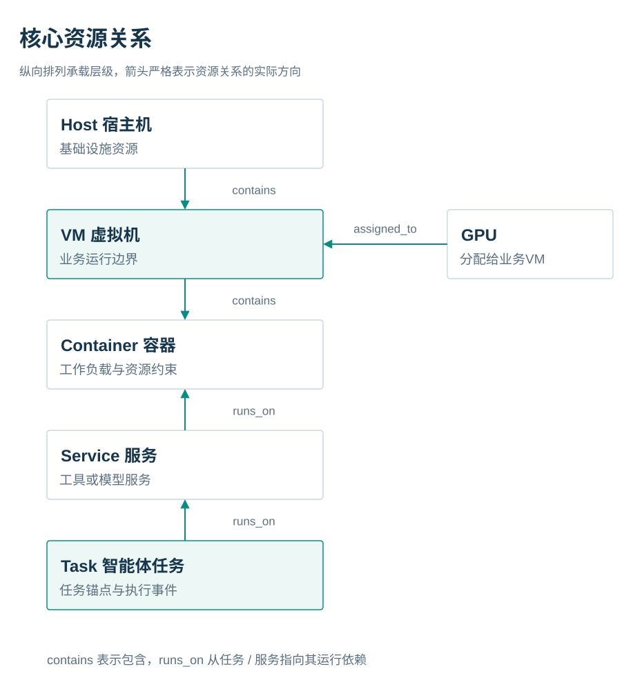
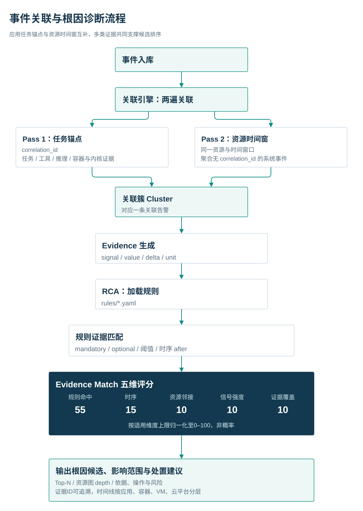

# TraceSphere Project Introduction

*Full-stack observability and root-cause diagnosis for containerized and agent workloads inside ZSvirt virtual machines*

[中文](../作品介绍.md) | English

---

## Positioning

TraceSphere targets AI workloads running inside ZSvirt virtual machines. It puts ZSvirt infrastructure resources, VM-level container and process signals, model-service metrics, agent task events, and GPU memory signals into one traceable evidence chain and answers a practical operational question:

> When an agent task fails, does the cause come from the application, the tool service, the container, the VM, the GPU, or the host?

The project is organized around three principles:

| Principle | Design implication |
|---|---|
| VM as the boundary | The ZSvirt VM is the connection point between infrastructure and workload |
| Workload as the object | Containers, services, tasks, model inference, and GPU usage have queryable identities |
| Event correlation as the core | `resource_id`, `correlation_id`, `task_id`, and time windows establish evidence relationships |

The project name, component names, and runtime entry points are all **TraceSphere**. The historical draft `方案初版.md` is a process record; the current reference is this document, the README, and the solution overview.

## Background and problem

AI workloads span multiple runtime layers: host, GPU/vGPU, VM, container, model service, and agent task. Failures often fall outside the cloud platform's resource view:

- A container reaches its memory limit and is OOM-killed; tool calls then fail.
- CPU contention inside one VM increases model latency and makes an agent task time out.
- A tool proxy becomes unreachable; the application only sees a `tool.result` error.
- GPU memory approaches its limit and the model service or agent task is affected.

Looking at ZSvirt, Prometheus, container logs, or application logs separately makes it hard to tell whether these signals belong to the same failure. TraceSphere organizes resource identity, runtime signals, application events, correlation clusters, and remediation advice into one operational view.

## Architecture


The system has three clearly separated data paths: ZSvirt infrastructure synchronization, VM-side signal collection, and platform-side correlation and diagnosis. The platform owns normalization, the resource graph, correlation, and evidence storage. RCA only consumes structured context and applies YAML rules. The Console and CLI present the result.

### Key components

| Component | Responsibility | Implementation |
|---|---|---|
| `platform` | ZSvirt sync, resource graph, event normalization, correlation clusters, evidence storage | Python, SQLite WAL, REST / Fixture providers |
| `vm-agent` | VM-side kernel and resource signal collection | Go, cilium/ebpf, PSI, cgroup v2, journal |
| `workload` | Reproducible AI agent chain and fault injection | Docker Compose, llama.cpp, Toxiproxy, Prometheus, cAdvisor |
| `rca` | Rule-driven root-cause diagnosis and CLI/API | Go, YAML Rule Engine, Evidence Match |
| `console` | Topology, health, incident detail, diagnosis, metric charts | React, TypeScript, G6, ECharts, Ant Design |

## Data model and evidence chain

### Resource relations

TraceSphere uses `<kind>:<key>` resource identifiers. The core relations are:



Application events connect an agent task through `correlation_id` and `task_id`. System events join the same correlation cluster through container identity, VM ownership, and time windows. The identity mapping resolves PID → cgroup → container ID and VM UUID, so eBPF OOM, process, and network events land on a concrete resource instead of remaining isolated.

### Schema v1

The unified event fields are:

```text
schema_version / origin / mode / observed_at / ingested_at / type / event_type /
resource_id / correlation_id / task_id / severity / source / cluster_id / payload
```

After ingestion, events go through a field whitelist, identity completion, deduplication, and time normalization. Business text does not enter the event body. The agent side keeps only lengths and structured metadata for questions, answers, and results.

### Collection and degradation

| Signal | Collection method | Frequency / behavior |
|---|---|---|
| ZSvirt resources and alarms | Read-only REST sync | Startup sync; `ZSVIRT_SYNC_INTERVAL` defaults to 120 s |
| Container memory and CPU | cgroup v2 | 15 s direct report |
| VM pressure | `/proc/pressure/*` | 5 s sampling |
| Process, OOM, TCP retransmit | eBPF tracepoints | Real time; each hook degrades independently |
| Kernel OOM | journal pattern matching | Polled and deduplicated |
| Agent task, tool, inference | AppEvent | Real-time direct report |
| Container and model metrics | Prometheus / cAdvisor / llama.cpp | 5 s scrape |
| GPU memory | Mock DCGM or real DCGM exporter | 15 s report |

Without a GPU, Mock DCGM is used. Without eBPF, PSI, cgroup, and journal collection remain. When the platform is temporarily unreachable, vm-agent writes events to a local spool and retries. FixtureProvider can replay captured real exercise data offline.

## Diagnosis loop

TraceSphere does not emit an unexplained guess. It separates a diagnosis into five evidence dimensions:



### Evidence Match five dimensions

| Dimension | Max | Meaning |
|---|---:|---|
| Rule evidence match | 55 | How many YAML clauses were hit (required, optional, threshold, increase) |
| Temporal precedence | 15 | Whether the root-cause signal precedes the business failure |
| Resource adjacency | 10 | Same resource, same VM, or graph adjacency |
| Signal strength | 10 | Severity, threshold exceedance, and increase strength |
| Independent evidence | 10 | Independence of cgroup, eBPF, metric, app-event, and other sources |

The page and CLI show evidence IDs, source, time, value, affected resources, and suggested actions. The score explains evidence coverage; **it is not a probability and does not represent general accuracy**.

## Scenarios and real acceptance

The latest real-data acceptance used `platform=real`, `prometheus=real`, and `fixture=off`. The evidence directory keeps a historical batch name, but the report window is 2026-09-30.

| Scenario | Fault injection | Key cross-layer evidence | Top-1 result |
|---|---|---|---:|
| Case 1: container OOM | Tighten the `tool-service` memory limit | `memory.events.oom_kill`, `oom.ebpf`, container restart, `task.failed` | Container memory exhausted, 99/100 |
| Case 2: CPU contention | `cpu-stress` + tighten the model-service CPU quota | PSI `cpu.some`, CPU throttling, `task.failed` | CPU resource contention, 85/100 |
| Case 3: tool call failure | Disable or delay the Toxiproxy tool proxy | `tool.result` error, `task.failed` (application events) | Agent tool call failure, 67/100 |
| Case 4: GPU memory exhaustion | Mock DCGM `exhaust` mode | GPU memory ratio above 90%, `gpu.memory.exhausted` | GPU memory exhaustion, 89/100 |

Evidence boundaries:

- Case 3 evidence in the cited run was **application events only**. No transport-layer or kernel evidence was captured, so the result is not proof of a transport anomaly.
- Case 2 had no inference-latency evidence in the cited run; the conclusion rests on PSI, CPU throttling, and task failure.
- Case 4 is a degraded demonstration without GPU hardware. Mock DCGM uses `ts_gpu_*` metric names; the semantics are compatible with a real DCGM exporter, but the names are not real DCGM names. No real GPU validation was performed.
- The four scores are controlled-scenario results and are not a general accuracy claim.

## Security, privacy, and reproducibility


### Access control

- Platform uses `TRACESPHERE_API_TOKEN`; a non-loopback binding without a token is refused.
- RCA uses `TRACESPHERE_RCA_TOKEN`; all API requests except health require a Bearer token when it is configured.
- vm-agent, agent-service, and Mock DCGM report through a Bearer token injected by environment variable.
- Platform and RCA write endpoints are rate-limited per client IP per minute (default 600).
- Prometheus, cAdvisor, llama, Toxiproxy, Mock DCGM, and the agent `/task` endpoint bind to loopback by default; cross-host metric reads use an explicit `PROM_BIND`.
- ZSvirt is queried read-only: the code never calls resource write APIs. This is a code-discipline guarantee, not a restricted-account guarantee.

### Privacy minimization

The system does not upload agent questions, model answers, or tool result bodies. It keeps only lengths and structured metadata needed for diagnosis. Kernel logs are pattern-matched for OOM and only structured fields are reported. Event ingestion uses a field whitelist. Submission packages replace addresses, UUIDs, usernames, and passwords, and run a residue scan.

## Innovation

### Cross-layer resource graph and evidence chain

The core is not a single-metric collector. It treats `Host → VM → GPU → Container → Service → Task` as one resource graph. Application events enter through task anchors; system events enter through identity mapping; every diagnosis points back to original events and concrete resources.

### Explainable rule-driven RCA

RCA rules use YAML to describe signals, weights, thresholds, correlation constraints, and remediation. Adding a rule does not require engine changes. Five-dimensional Evidence Match breaks "why this conclusion" into auditable score details suitable for operations and post-incident review.

### Real collection and replay

Real ZSvirt, Prometheus, vm-agent, and agent events can be captured as fixtures. Mock DCGM covers the no-GPU path; PSI/cgroup/journal cover the no-eBPF path. Live exercises and offline demonstrations share the same data contract.

### Low-intrusion probe with self-healing

vm-agent is a single binary managed by systemd. Each hook degrades independently, and failed reports go to a local spool for retry. In the published test on a 4 vCPU / 4 GiB Ubuntu 24.04 VM, idle average CPU was below 1% with an 11 MB maximum RSS; under load, average CPU remained below 1% with a 12 MB maximum RSS. These are measurements for that environment, not a performance guarantee for all kernels and workloads.

## Delivery forms

| Entry point | Audience | Main capability |
|---|---|---|
| Web Console | SRE, platform operations, reviewers | Topology, health, incident detail, remediation, metric charts |
| CLI | Automation, on-site troubleshooting | `health`, `topo`, `alerts`, `diagnose`, fixture replay |
| Platform API | Collectors and upper-layer services | Resources, events, evidence, correlation clusters, aggregated context |
| YAML rule library | Engineering and operations | New failure types, threshold changes, remediation definitions |

Recommended demo path: normal workload → inject OOM/CPU/tool/GPU faults → inspect health changes → open the correlation cluster → review the evidence timeline → show the Top-1 root cause, impact scope, and remediation advice.

## Boundaries

- Current results cover four controlled failure scenarios with a defined collection configuration and rule library. The project does not claim production-wide validation or general accuracy.
- No real GPU / vGPU / DCGM exporter environment was tested.
- No Kubernetes, multi-cluster, or multi-tenant deployment was tested.
- No Alertmanager is deployed; incident aggregation and three-state operations are implemented in-house. Grouping, inhibition, and notification channels are out of scope.
- The resource graph is SQLite edge tables plus a shallow BFS (one hop in correlation, depth 2 for impact scope); it is not a graph database.
- No Fluent Bit/Loki log pipeline and no distributed tracing are included; the `trace_id` column exists but has no producer.
- eBPF hooks are tracepoints; there are no kprobes.
- Evidence Match is a rule-evidence hit score, not a probability.

## Links

- [Project README](../../README.en.md)
- [Solution overview](solution-overview.md)
- [Deployment guide](deployment-guide.md)
- [Testing guide](testing-guide.md)
- [User guide](user-guide.md)
- [Four-scenario acceptance evidence](../evidence/acceptance-2026-09-21/)
- [Probe overhead report](../evidence/vm-agent-overhead.md)
- [Editable Draw.io sources](../作品介绍/drawio/)
- [Mermaid sources](../作品介绍/diagrams/)

---

*Document version: 2026-10-27 (English edition) · Scope: the 2026-09-30 real-data acceptance and the current security baseline.*
